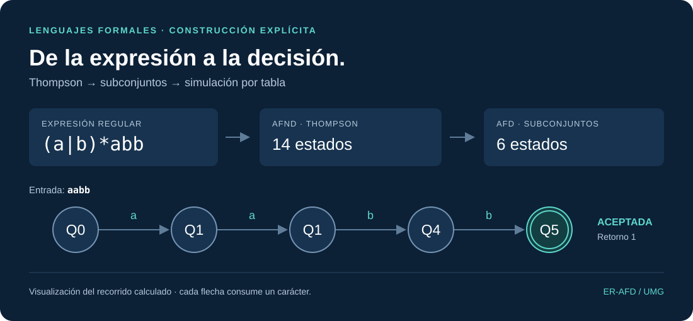
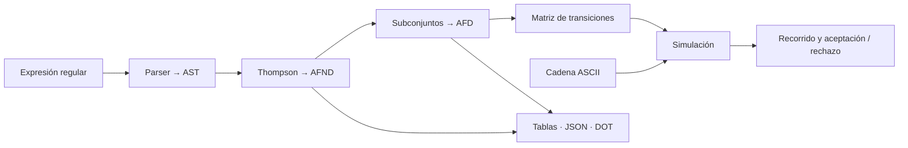
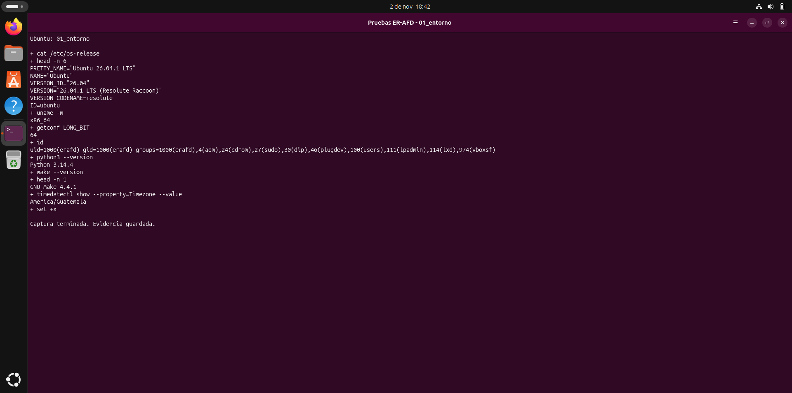
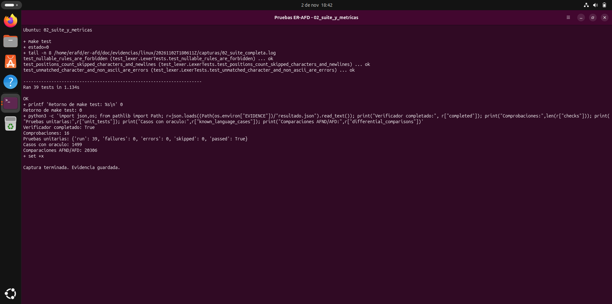
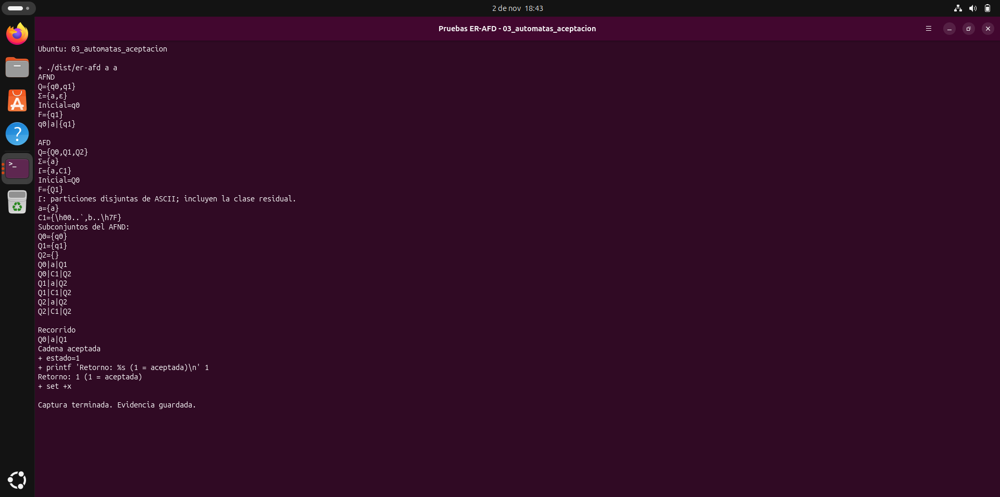
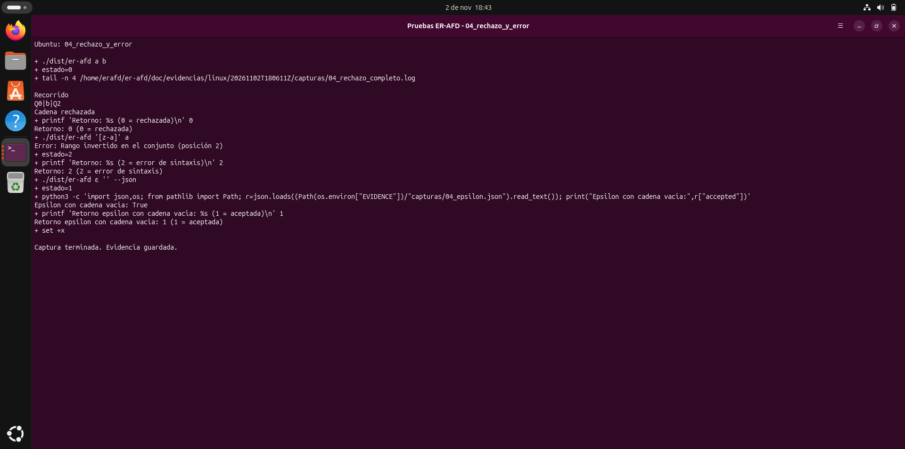
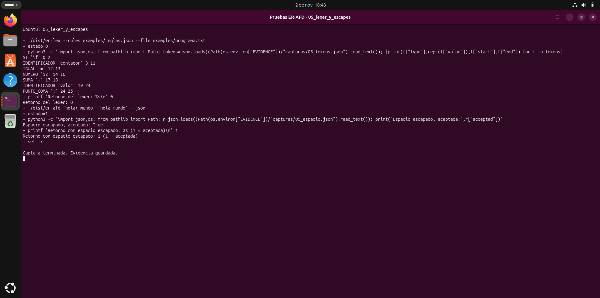
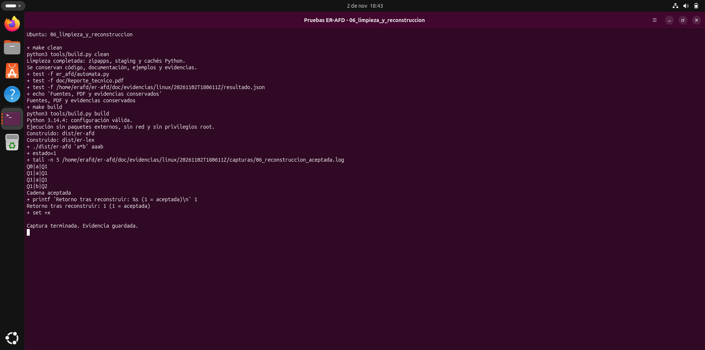

<div align="center">

# ER-AFD

**Convertidor de expresiones regulares a autómatas finitos**

Escribe una expresión y una cadena. ER-AFD construye el AFND con Thompson,
obtiene el AFD por subconjuntos y muestra sus tablas y el recorrido de la entrada.

[](https://github.com/Medec92227/er-afd/actions/workflows/ci.yml)


**[Instalación](#instalación)** · [Uso](#uso) · [Métricas](#pruebas-y-métricas) · [Capturas de Ubuntu](#capturas-de-ubuntu) · [Documentación PDF](#documentación)



</div>

## Qué hace

El proyecto permite observar la conversión completa de una ER y comprobar la pertenencia de una cadena a su lenguaje. Los estados y las transiciones se generan a partir del patrón; el reconocimiento consulta la matriz del AFD construido.

| Funcionalidad | Resultado |
| --- | --- |
| **Conversión explícita** | Parser propio, construcción de Thompson, épsilon-cierre y construcción de subconjuntos. |
| **Tablas de ambos autómatas** | Estados, alfabetos, transiciones, estados iniciales/finales y correspondencia entre subconjuntos. |
| **Simulación completa** | Un paso por carácter y resultado `Cadena aceptada` o `Cadena rechazada`. |
| **Sintaxis del proyecto** | Unión, concatenación, Kleene, agrupación, punto, épsilon, conjuntos, rangos, complementos y escapes. |
| **ASCII completo** | Códigos 0 a 127; lectura de archivos conservando sus bytes y saltos de línea. |
| **Herramientas adicionales** | Salida JSON, exportación DOT y tokenizador multirregla `er-lex`. |
| **Ejecución reproducible** | Biblioteca estándar, Makefile, pruebas automatizadas y evidencia de Ubuntu con usuario regular. |

El núcleo implementa los algoritmos sin usar `re` ni motores externos de expresiones regulares. La [auditoría de implementación](doc/AUDITORIA_IMPLEMENTACION.md) señala las funciones y el flujo de reconocimiento.

## Instalación

Requisitos: **Linux de 64 bits, Python 3.10 o posterior y GNU Make**. Con Python y Make instalados, la configuración y construcción no requieren Internet, paquetes de Python ni permisos de administrador.

```bash
git clone https://github.com/Medec92227/er-afd.git
cd er-afd
make config
make build
make test
```

Para usar los ejecutables desde esa terminal:

```bash
export PATH="$PWD/dist:$PATH"
er-afd '(a|b)*abb' 'aabb'
printf 'Código de retorno: %s\n' "$?"
```

También puedes ejecutar `python3 dist/er-afd ...`, `python3 er-afd ...` o `python3 -m er_afd ...`.

**Una aceptación devuelve 1**, por exigencia del enunciado. Es un resultado semántico de ER-AFD; maneja ese retorno si usas `set -e` y evita encadenar una aceptación directamente con `&&`.

## Uso

```text
er-afd <ER> <cadena>
er-afd <ER> --file <archivo>
```

```bash
er-afd '(a|b)*abb' 'aabb'           # Aceptación: 1
er-afd '(a|b)*abb' 'aaba'           # Rechazo: 0
er-afd '[z-a]' 'a'                 # Error de sintaxis: 2
er-afd 'hola\ mundo' 'hola mundo'  # Espacio literal
er-afd '\N\N*' '2026' --json      # Dígitos y salida JSON
er-afd 'a*b' 'aaab' --dot automata # Exportación de ambos autómatas
```

Además de las tablas, el primer ejemplo muestra este recorrido:

```text
Q0|a|Q1
Q1|a|Q1
Q1|b|Q4
Q4|b|Q5
Cadena aceptada
```

| Código de `er-afd` | Significado |
| --- | --- |
| **1** | Cadena aceptada. |
| **0** | Cadena rechazada. |
| **2** | Error de sintaxis, entrada, archivo o límite de recursos. |

Para analizar un archivo con varias reglas:

```bash
python3 dist/er-lex --rules examples/reglas.json --file examples/programa.txt
```

`er-lex` elige la coincidencia más larga; en empate gana la primera regla. Permite omitir tokens con `skip` y devuelve **0** en éxito o **2** en error.

Consulta la [referencia completa de CLI y sintaxis](doc/REFERENCIA_CLI.md) para escapes, archivos, opciones y límites. Por ejemplo, `\h09` representa TAB y `\h0A` representa LF; `\t` y `\n` son escapes genéricos de las letras `t` y `n`.

## Arquitectura



Las clases solapadas se convierten en particiones disjuntas sobre ASCII. El AFD tiene un destino por estado y carácter, con estado pozo cuando es alcanzable. Se conserva la relación con los subconjuntos del AFND; no se aplica minimización.

## Pruebas y métricas

Ejecución local registrada en **Ubuntu Desktop 26.04.1 LTS x86_64**, Python **3.14.4**, GNU Make **4.4.1** y usuario regular **UID 1000**. Las dos baterías se presentan por separado para conservar el histórico.

### Batería original

| Medición | Resultado observado |
| --- | --- |
| Métodos de prueba `unittest` | **39 aprobados**, 0 fallos, errores u omitidos |
| Casos con oráculo independiente | **1,499 / 1,499 correctos** |
| Matriz de confusión | **710 TP · 789 TN · 0 FP · 0 FN** |
| Exactitud, precisión y sensibilidad en ese corpus | **100 %** |
| Comparaciones AFND frente a AFD | **20,306 / 20,306 coincidentes** |
| Comprobaciones del verificador Linux | **16 / 16 correctas** |

Las comparaciones diferenciales corresponden a **26 patrones × 781 cadenas** de longitud 0 a 4 sobre `abc1 `, incluido el espacio. AFND y AFD comparten el parser y la construcción de Thompson; esta comparación respalda principalmente la determinización.

[Métricas originales de Ubuntu](doc/evidencias/linux/20261102T180611Z/metricas_linux.json) · [Registro del verificador](doc/evidencias/linux/20261102T180611Z/resultado.json) · [Guía de evidencia](doc/evidencias/linux/20261102T180611Z/LEEME_EVIDENCIAS.md)

### Batería adicional

| Medición | Resultado observado |
| --- | --- |
| Nuevos pares ER/entrada | **800 / 800 correctos**, distintos de los pares del corpus original |
| Matriz de confusión | **222 TP · 578 TN · 0 FP · 0 FN** |
| Patrones inválidos nuevos | **9 detectados** |
| Procesos CLI y salida JSON | **25 / 25 con el retorno esperado** |
| Integridad de las métricas históricas | **SHA-256 idénticos antes y después** |

Los nueve patrones inválidos también están dentro de las 25 comprobaciones CLI. Son conteos de distinto nivel y no se suman como procesos extra. Los 800 casos cubren controles ASCII, conjuntos negativos, escapes, caracteres especiales y errores de entrada.

[Resultado adicional](doc/evidencias/linux/adicionales_20261103T033444Z/resultado_adicional.json) · [Metodología y reproducción](doc/PRUEBAS_ADICIONALES.md)

Los porcentajes describen **muestras finitas**, no una garantía para todas las expresiones o entradas posibles. La validación local de Ubuntu conserva sus propios registros; el estado actual de CI está en [GitHub Actions](https://github.com/Medec92227/er-afd/actions/workflows/ci.yml), con ejecuciones para Python **3.10, 3.12 y 3.14**.

Para repetir sin sobrescribir el histórico:

```bash
make test
python3 -m tests.run_validation --output "$HOME/erafd-metricas-$(date -u +%Y%m%dT%H%M%SZ).json"
python3 -m tests.additional_validation --output "$HOME/erafd-adicionales-$(date -u +%Y%m%dT%H%M%SZ).json"
```

## Capturas de Ubuntu

**Seis capturas reales de la VM**, con los PNG originales y los registros de ejecución. Pulsa una imagen para verla a tamaño completo. También están incorporadas en las páginas **6 a 11** del PDF de casos de prueba.

<table>
  <tr>
    <td width="50%"><a href="doc/evidencias/linux/20261102T180611Z/01_entorno.png"></a><br><sub><b>Entorno</b>: Ubuntu, Python, Make y usuario regular.</sub></td>
    <td width="50%"><a href="doc/evidencias/linux/20261102T180611Z/02_suite_y_metricas.png"></a><br><sub><b>Suite y métricas</b>: Pruebas originales y resultados registrados.</sub></td>
  </tr>
  <tr>
    <td width="50%"><a href="doc/evidencias/linux/20261102T180611Z/03_automatas_aceptacion.png"></a><br><sub><b>Autómatas y aceptación</b>: Tablas, recorrido y retorno 1.</sub></td>
    <td width="50%"><a href="doc/evidencias/linux/20261102T180611Z/04_rechazo_y_error.png"></a><br><sub><b>Rechazo y error</b>: Retornos 0/2 y cadena vacía.</sub></td>
  </tr>
  <tr>
    <td width="50%"><a href="doc/evidencias/linux/20261102T180611Z/05_lexer_y_escapes.png"></a><br><sub><b>Lexer y escapes</b>: Tokens, posiciones y espacio literal.</sub></td>
    <td width="50%"><a href="doc/evidencias/linux/20261102T180611Z/06_limpieza_y_reconstruccion.png"></a><br><sub><b>Limpieza y reconstrucción</b>: Conservación de documentos y nueva ejecución.</sub></td>
  </tr>
</table>

## Documentación

| Documento | Contenido |
| --- | --- |
| [**Reporte técnico · PDF**](doc/Reporte_tecnico.pdf) | 9 páginas: algoritmos, diagramas, matrices y auditoría de implementación. |
| [**Manual de usuario · PDF**](doc/Manual_usuario.pdf) | 5 páginas: instalación, ejecución y códigos de retorno. |
| [**Casos de prueba · PDF**](doc/Casos_de_prueba.pdf) | 13 páginas: metodología, métricas, seis capturas de Ubuntu y resultados adicionales. |
| [Matriz de cumplimiento](doc/CUMPLIMIENTO.md) | Requisito del enunciado y evidencia correspondiente. |
| [Pasos de pruebas en Ubuntu](doc/PASOS_PRUEBAS_UBUNTU.md) | Reproducción de las pruebas y capturas. |
| [Guion de defensa](doc/DEFENSA.md) | Demostración, diseño, métricas y preguntas en 10 minutos. |

Los PDF mantienen el formato universitario y las portadas de los integrantes. [Fuentes y asistencia utilizada](FUENTES.md).

## Makefile

| Operación | Efecto |
| --- | --- |
| `make config` | Comprueba Python y los requisitos. |
| `make build` | Construye los zipapps ejecutables `dist/er-afd` y `dist/er-lex`. |
| `make run` | Ejecuta el ejemplo y maneja los códigos semánticos 1/0. |
| `make test` | Ejecuta la suite original de `unittest`. |
| `make clean` | Elimina construcción y cachés; conserva fuentes, PDF y evidencias. |

```bash
make run ER='(a|b)*abb' CADENA='aabb'
make clean
```

## Estructura del repositorio

```text
er_afd/                 Parser, Thompson, subconjuntos, simulación, CLI y lexer
tests/                  Suite original y batería adicional separada
examples/               Patrones, reglas y archivos de demostración
tools/                  Construcción y verificador Linux
doc/                    Tres PDF, auditoría, guías y evidencia reproducible
doc/img/                Visualización del ejemplo calculado
.github/workflows/      Verificación automática en Ubuntu
Makefile                config · build · run · test · clean
FUENTES.md              Referencias y declaración de asistencia
```

Los ejecutables de `dist/` se generan con `make build`. El manifiesto `SHA256SUMS.json` pertenece al ZIP de distribución, no al repositorio de fuentes.

## Integrantes

Proyecto **ER-AFD** · **Universidad Mariano Gálvez de Guatemala** · Docente: **René Ornélyz**.

- **Carlos Abraham Méndez Asencio** · Carné **94902417370**
- **Maycol Alexander Ortiz Flores** · Carné **9490-24-27213**

Repositorio de entrega: **[Medec92227/er-afd](https://github.com/Medec92227/er-afd)**.
