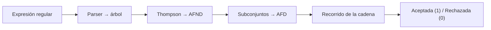

<div align="center">

# ER-AFD

**Convertidor de expresiones regulares a autómatas finitos deterministas**

Recibe una expresión regular y una cadena. Construye el AFND con el algoritmo de Thompson,
lo convierte en AFD con la construcción de subconjuntos y recorre la matriz de transiciones
para decir si la cadena se acepta o se rechaza.

[](https://github.com/Medec92227/er-afd/actions/workflows/ci.yml)


**[🌐 Probar en línea](https://mango-beach-0a540511e.3.azurestaticapps.net)** · [Instalación](#instalación) · [Uso](#uso) · [Sintaxis](#sintaxis) · [Pruebas](#pruebas-y-métricas) · [Documentación (PDF)](doc/)

</div>

---

## Características

| | |
|---|---|
| **ER → AFND → AFD** | Parser descendente recursivo propio, construcción de Thompson, cerradura ε y construcción de subconjuntos. Sin `re` ni otras librerías de regex. |
| **Tablas de ambos autómatas** | Estados, alfabeto, estados finales y transiciones con el formato `estado\|símbolo\|destino` del enunciado. |
| **Recorrido paso a paso** | Muestra cada transición del AFD y termina en `Cadena aceptada` o `Cadena rechazada`. |
| **Código de retorno** | `1` aceptada, `0` rechazada, `2` error en la expresión o en la entrada. |
| **Extras** | `--verbose` (subconjuntos del AFND), `--json`, `--dot` para Graphviz, `--file` y el tokenizador `er-lex` para varias reglas. |
| **Pruebas** | 42 pruebas unitarias y métricas de precisión con `make metricas`. |

## Instalación

Requisitos: Linux de 64 bits, Python 3.10 o superior y `make`. No necesita permisos de root ni paquetes extra.

```bash
git clone https://github.com/Medec92227/er-afd.git
cd er-afd
make config
make build
```

| Comando | Qué hace |
|---|---|
| `make config` | Revisa la versión de Python. |
| `make build` | Genera los ejecutables `dist/er-afd` y `dist/er-lex`. |
| `make run` | Ejecuta el ejemplo `(a\|b)*abb` con `aabb`. Acepta `ER=` y `CADENA=`. |
| `make test` | Corre las pruebas unitarias. |
| `make metricas` | Calcula las métricas de precisión y las guarda en `doc/metricas.json`. |
| `make web` | Arma la página web en `dist/web`. |
| `make clean` | Borra `build/`, `dist/` y las cachés de Python. |

## Uso

```text
er-afd <ER> <cadena>
```

```bash
export PATH="$PWD/dist:$PATH"
er-afd 'ab*' 'abb'
echo $?        # 1
```

Salida:

```text
AFND
Q={q0,q1,q2,q3,q4,q5}
Σ={a,b,ε}
F={q5}
q0|a|{q1}
q1|ε|{q4}
q2|b|{q3}
q3|ε|{q2,q5}
q4|ε|{q2,q5}

AFD
Q={Q0,Q1,Q2}
Σ={a,b}
F={Q1,Q2}
Q0|a|Q1
Q1|b|Q2
Q2|b|Q2

Q0|a|Q1
Q1|b|Q2
Q2|b|Q2
Cadena aceptada
```

`q0` y `Q0` son siempre los estados iniciales. Si un símbolo no tiene transición desde el estado actual,
el recorrido se detiene ahí y la cadena se rechaza.

Más ejemplos:

```bash
er-afd '(a|b)*abb' 'aaba'           # rechazada, retorno 0
er-afd 'hola\ mundo' 'hola mundo'   # espacio con escape
er-afd "hola mundo" "hola mundo"    # espacio con comillas
er-afd '\A\a*' 'Guatemala'          # mayúscula seguida de minúsculas
er-afd '\N\N*' '2026' --verbose     # muestra también los subconjuntos del AFND
er-afd 'a*b' 'aaab' --dot automata  # genera automata.afnd.dot y automata.afd.dot
er-afd '[z-a]' 'a'                  # error de sintaxis, retorno 2
```

Tokenizar un archivo con varias reglas:

```bash
er-lex --rules examples/reglas.json --file examples/programa.txt
```

## Página web

En línea: **https://mango-beach-0a540511e.3.azurestaticapps.net**

La carpeta `web/` tiene una versión en el navegador. Usa el mismo paquete `er_afd`, que se ejecuta
con [Pyodide](https://pyodide.org), y además dibuja el AFND y el AFD y anima el recorrido paso a paso.

```bash
make web
python3 -m http.server 8000 -d dist/web   # abrir http://localhost:8000
```

Se publica en Azure Static Web Apps con el workflow `.github/workflows/web.yml` cuando el repositorio
tiene el secreto `AZURE_STATIC_WEB_APPS_API_TOKEN`.

## Sintaxis

| Símbolo | Significado |
|---|---|
| `ab` | Concatenación (implícita) |
| `a\|b` | Unión |
| `a*` | Cerradura de Kleene |
| `(r)` | Agrupación |
| `.` | Cualquier carácter ASCII |
| `ε` | Cadena vacía |
| `[abc]` `[a-z]` `[^abc]` | Conjunto, rango y conjunto negativo |
| `\*` `\\` `\p` | Escape: el carácter siguiente se toma literal |
| `\N` | Dígito, `[0-9]` |
| `\A` / `\a` / `\z` | Mayúscula / minúscula / cualquier letra |
| `\hXX` | Carácter ASCII por su código hexadecimal, por ejemplo `\h20` es el espacio |

Precedencia, de mayor a menor: paréntesis, `*`, concatenación y `|`. No se implementan `+`, `?` ni `{m,n}`;
para "uno o más" se escribe `rr*`.

## Cómo funciona



| Archivo | Contenido |
|---|---|
| `er_afd/parser.py` | Parser descendente recursivo: valida la ER y arma el árbol de sintaxis. |
| `er_afd/automata.py` | Thompson, cerradura ε, construcción de subconjuntos, simulación y formato de las tablas. |
| `er_afd/cli.py` | Interfaz de línea de comando `er-afd`. |
| `er_afd/lexer.py` | Tokenizador `er-lex` (coincidencia más larga y prioridad por orden de reglas). |
| `tests/` | Pruebas unitarias, casos esperados y cálculo de métricas. |
| `tools/build.py` | Pasos que ejecuta el Makefile. |

## Pruebas y métricas

```bash
make test
make metricas
```

| Prueba | Resultado |
|---|---|
| Casos con resultado esperado (1499) | 1499 correctos: 710 VP, 789 VN, 0 FP, 0 FN |
| AFD contra simulación directa del AFND | 20306 de 20306 cadenas coinciden (26 expresiones) |
| Pruebas unitarias | 42 de 42 |

## Documentación

En [`doc/`](doc/):

- [Reporte técnico](doc/Reporte_tecnico.pdf): algoritmos usados para pasar de ER a AFD.
- [Casos de prueba](doc/Casos_de_prueba.pdf): ejecuciones con capturas de pantalla.
- [Manual de usuario](doc/Manual_usuario.pdf): instalación y uso.

## Autores

Proyecto del curso, Universidad Mariano Gálvez de Guatemala.

- Carlos Abraham Méndez Asencio
- Maycol Alexander Ortiz Flores

Referencias en [FUENTES.md](FUENTES.md).
