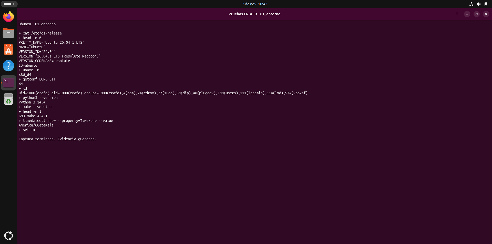
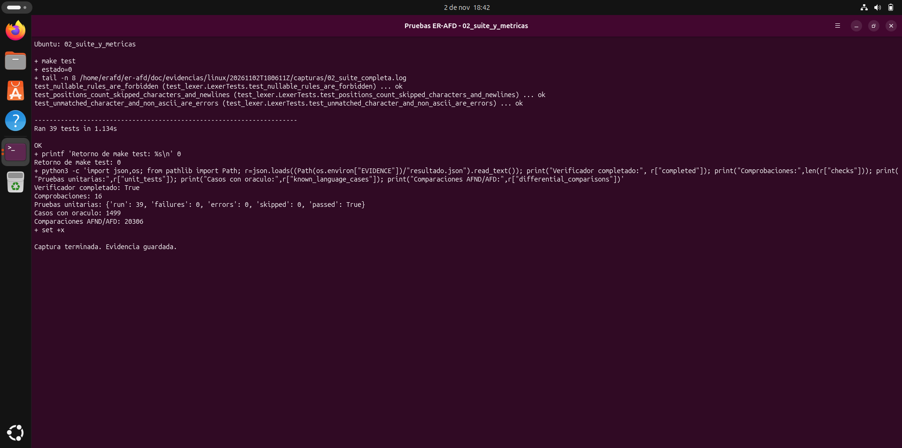
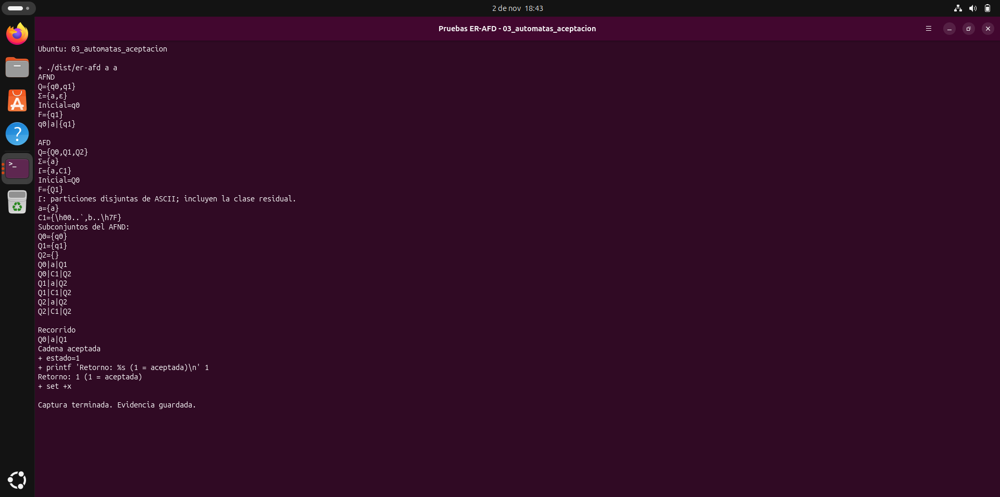
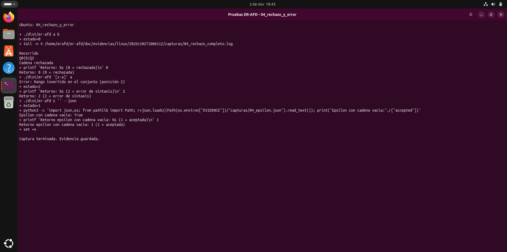
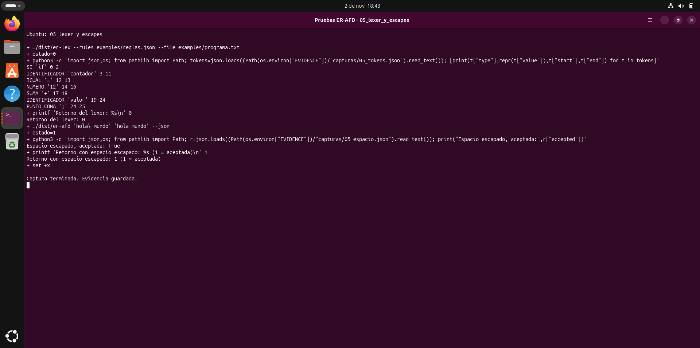
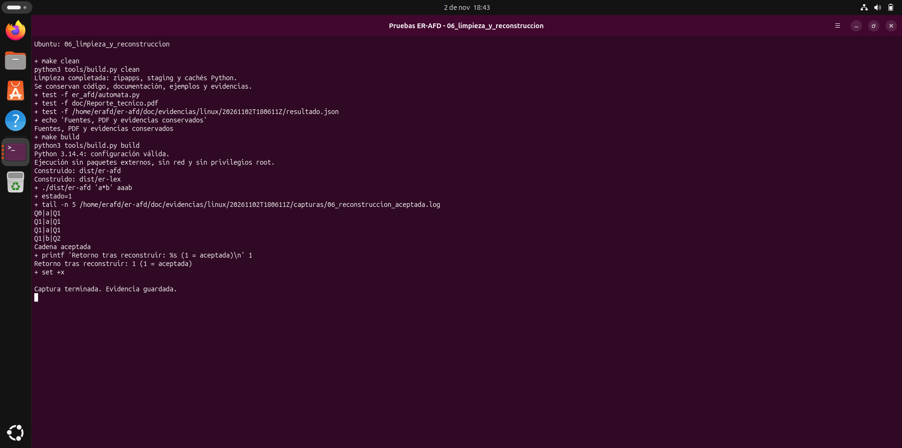

# Evidencia real de Ubuntu — ER-AFD

Fecha local: 2 de noviembre de 2026 (Guatemala). Ubuntu Desktop 26.04.1 LTS, x86_64, Python 3.14.4, GNU Make 4.4.1; usuario erafd, UID 1000, sin sudo para las pruebas.

| Comprobación | Resultado observado |
| --- | --- |
| Verificador | 16 de 16 pasos con retorno esperado |
| Unitarias | 39 aprobadas; 0 fallos y 0 errores |
| Casos con oráculo | 1499 correctos: TP 710, TN 789, FP 0, FN 0 |
| Comparaciones AFND/AFD | 20306 acuerdos de 20306; 0 diferencias |
| Ejecutable Unix directo | Aceptación con retorno 1 |
| Espacio escapado en Bash | Aceptación con retorno 1 |

Los registros y las métricas corresponden a la ejecución real del verificador. Las capturas se tomaron del framebuffer de la VM mediante VirtualBox durante ejecuciones reales en la terminal de Ubuntu. Las capturas incluyen un caso pequeño para que las dos tablas y el recorrido quepan completos. Para ver toda la salida de los casos grandes, consulta los registros.

La carpeta usa un identificador UTC generado en Windows; los registros conservan la hora que informó el invitado. Las capturas se completaron posteriormente ese mismo día local. No se modificaron los textos de las imágenes.

Archivos principales: [resultado.json](resultado.json), [metricas_linux.json](metricas_linux.json), [transcripcion.log](transcripcion.log), [retornos.tsv](retornos.tsv), [hash de fuentes ejecutadas](codigo_ejecutado_sha256.json) y [SHA-256 de evidencias](SHA256_EVIDENCIAS.json).

## Ubuntu, arquitectura de 64 bits, usuario normal, Python y Make

## Suite aprobada y métricas de la ejecución Linux

## AFND, AFD, clases, estados, recorrido y aceptación con retorno 1

## Rechazo 0, error de sintaxis 2 y epsilon con cadena vacía

## Siete tokens, posiciones y espacio escapado en Bash

## Limpieza, conservación de archivos y reconstrucción funcional

Los tres PDF se actualizaron después de ejecutar estas pruebas. `pdf_antes_clean.json` identifica las versiones documentales que existían durante la comprobación de limpieza; esos registros históricos permanecen intactos. La actualización posterior de los PDF no es un cambio producido por `make clean`.
